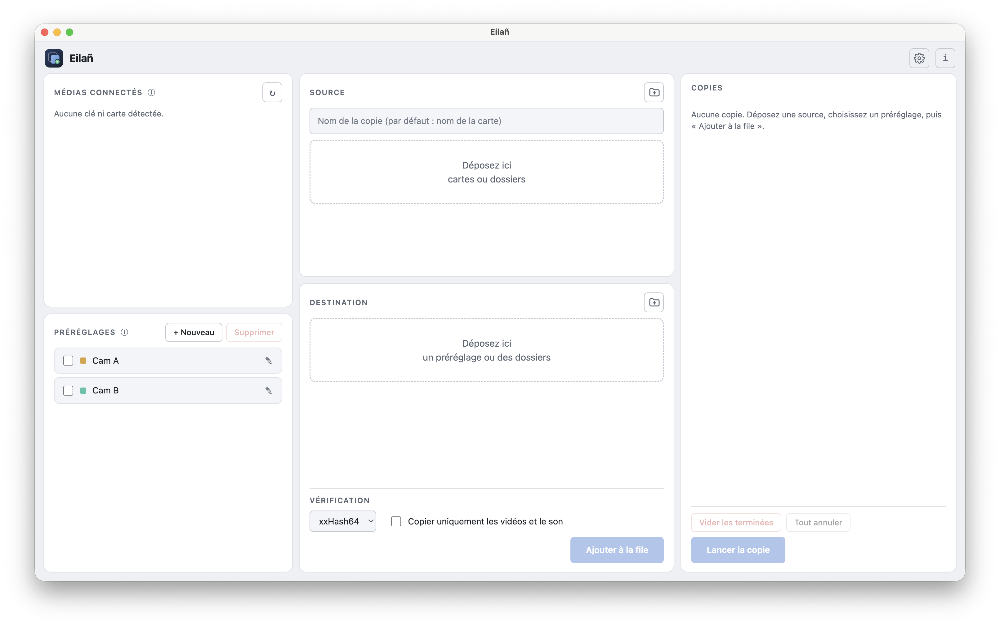

<p align="center">
  
</p>

<h1 align="center">Eilañ</h1>

<p align="center">
  <strong>Copiez vos rushes en sécurité.</strong><br>
  Copie de cartes et de disques vers plusieurs destinations, avec vérification par empreinte et rapport.
</p>

<p align="center">
  Windows · macOS · Linux — Français · English · Brezhoneg
</p>

<p align="center"></p>

---

## Pourquoi Eilañ ?

Sur un tournage, une carte formatée trop tôt ne se rattrape pas. Eilañ copie les rushes sur
plusieurs disques en une seule lecture, relit chaque copie, compare les empreintes et ne donne le
feu vert que lorsque tout est identique à la source.

## Fonctions

- **Plusieurs destinations en une passe** : la source est lue une fois, écrite en parallèle partout.
- **Vérification** : xxHash64 (rapide) ou MD5, chaque destination est relue et comparée. Possibilité de copier sans vérification.
- **Copies sûres** : écriture sous un nom temporaire, renommage uniquement après contrôle. Un disque qui tombe en panne ne fait échouer que sa propre copie.
- **File d'attente** : ajoutez plusieurs cartes, la copie se déroule l'une après l'autre, avec pause et reprise.
- **Préréglages** : une « recette » par caméra (destinations, arborescence, vérification, numérotation des cartes) à glisser dans la zone Destination.
- **Arborescence automatique** : `{date}/{appareil}/{carte}`, numéro de jour `{jour}`, numérotation des cartes (A001, A002…).
- **Détection des cartes et clés** branchées, espace libre contrôlé avant la copie.
- **Rapport** PDF, texte ou Markdown, avec vignettes, codec, résolution et fréquence, écrit dans chaque destination.
- **Historique** des copies et repérage des cartes déjà copiées.
- Thème clair, foncé ou celui du système.

## Installation

Prérequis : [Node.js](https://nodejs.org) 20 ou plus récent.

```bash
git clone https://github.com/gwounal/eilan.git
cd eilan
npm install
npm start
```

Pour produire un exécutable (à lancer sur chaque système cible) :

```bash
npm run dist      # .exe (Windows), .dmg (macOS), .AppImage (Linux)
```

## Utilisation en bref

1. **Source** : branchez une carte (elle apparaît dans « Médias connectés ») ou déposez un dossier.
2. **Destination** : glissez un préréglage, ou ajoutez des dossiers à la main.
3. Choisissez la **vérification**, puis **Ajouter à la file**.
4. Lancez la copie. Le rapport est écrit dans chaque destination.

## Documentation

Le détail des préréglages, de l'arborescence, des réglages et du rapport est dans
[docs/DOCUMENTATION.md](docs/DOCUMENTATION.md).

## À propos du nom

**Eilañ** signifie « copier » en breton. Les traductions sont dans `src/i18n.js` ; la version
bretonne est une première version à faire relire.

## Statut

Projet en développement actif. Les retours et les signalements de bogues sont les bienvenus
dans l'onglet [Issues](https://github.com/gwounal/eilan/issues).
